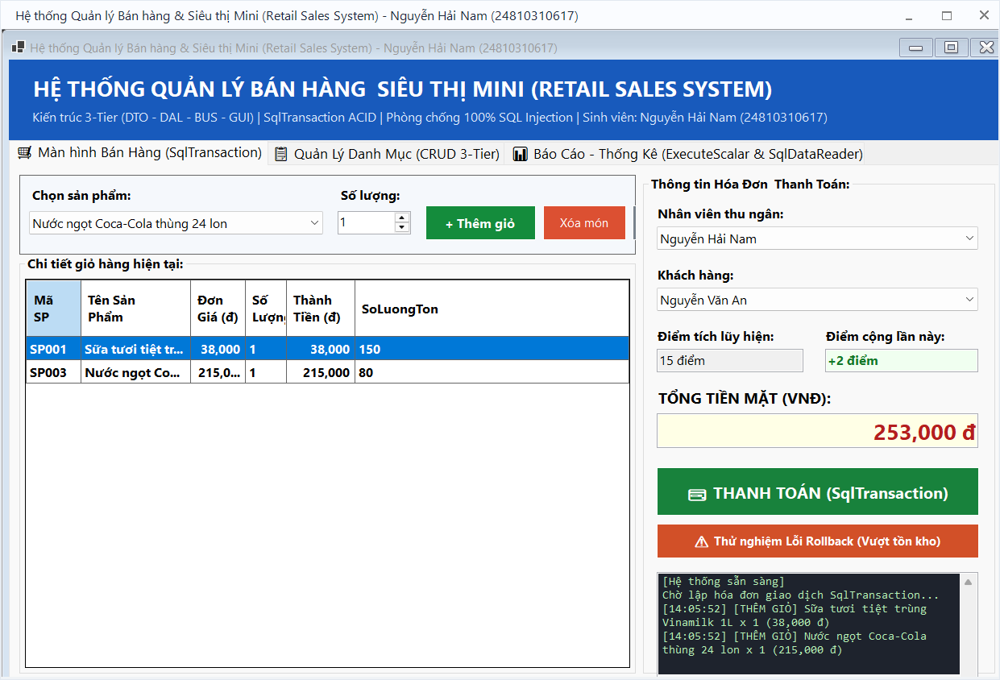
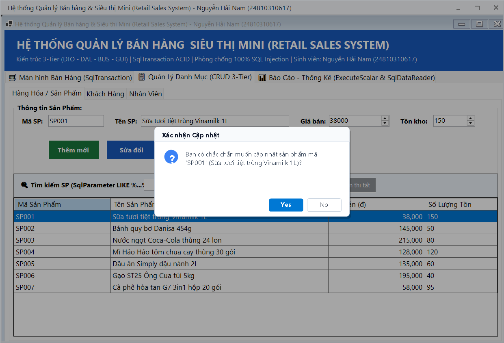
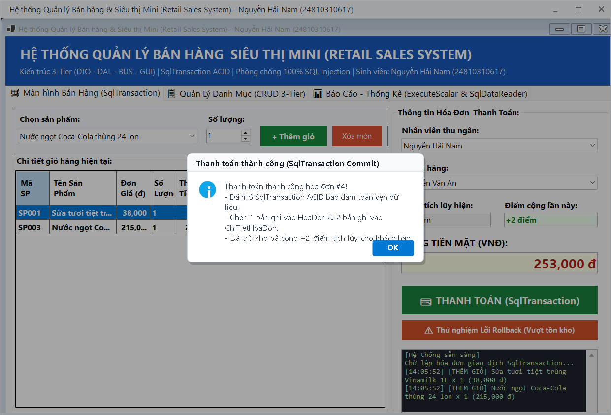
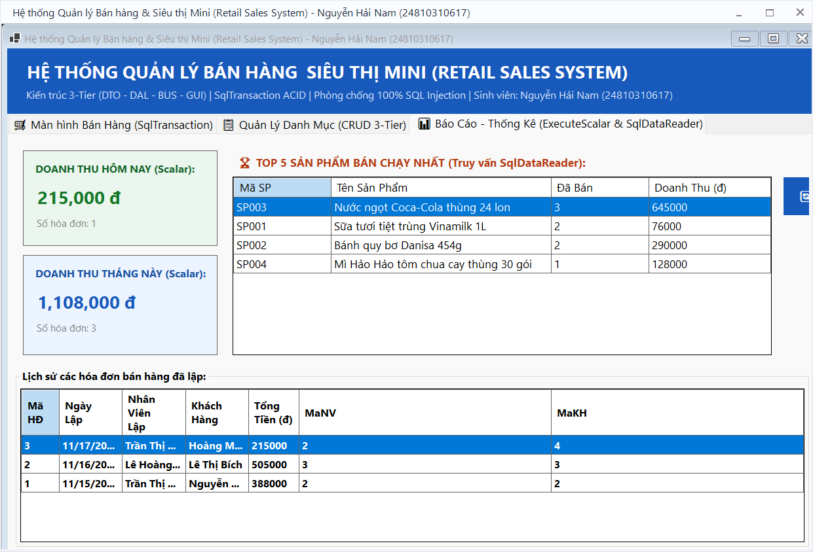
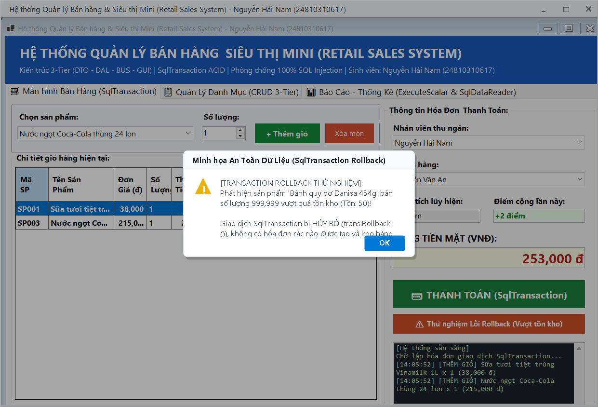

# BÁO CÁO ÔN TẬP THỰC HÀNH WINDOWS FORMS

## THÔNG TIN SINH VIÊN
- **Họ và tên:** Nguyễn Hải Nam
- **Mã số sinh viên:** 24810310617
- **Lớp:** D19CNPM3
- **Tên môn học:** Lập trình C# / Windows Forms (.NET 10)

---

## BÀI TẬP: BÀI 6.1 - HỆ THỐNG QUẢN LÝ BÁN HÀNG & SIÊU THỊ MINI (RETAIL SALES SYSTEM)

---

### MỤC 2: HÌNH ẢNH KẾT QUẢ CÁC MÀN HÌNH CHỨC NĂNG

#### 1. Màn hình Chính / Tổng quan hệ thống
Giao diện bán hàng chuyên nghiệp với danh mục sản phẩm, bộ chọn nhân viên thu ngân, khách hàng và giỏ hàng thời gian thực:


#### 2. Màn hình Quản lý Danh mục (CRUD - Thêm/Sửa/Xóa)
Quản lý danh mục Sản phẩm, Khách hàng, Nhân viên theo kiến trúc 3-Tier, có tìm kiếm `SqlParameter` và hộp thoại xác nhận an toàn:


#### 3. Màn hình Thực thi Nghiệp vụ chính (Lập Hóa đơn / Bán hàng - SqlTransaction)
Thực thi đồng thời 5 bước trong giao dịch `SqlTransaction` (HoaDon, ChiTietHoaDon, trừ SoLuongTon SanPham, cộng DiemTichLuy và gọi `trans.Commit()`):


#### 4. Màn hình Báo cáo - Thống kê
Sử dụng `ExecuteScalar` tính tổng doanh thu trong ngày/tháng và `SqlDataReader` hiển thị bảng xếp hạng Top 5 sản phẩm bán chạy nhất:


#### 5. Minh họa An toàn Dữ liệu (Phòng chống SQL Injection / Báo lỗi Transaction Rollback)
Thử nghiệm bán vượt số lượng tồn kho kích hoạt `trans.Rollback()` tức thời, bảo vệ dữ liệu kho không bị âm hoặc sai lệch:


---

### MỤC 3: CẤU TRÚC CƠ SỞ DỮ LIỆU (SalesDB)

```sql
-- 1. NhanVien (Nhân viên bán hàng)
-- MaNV (INT IDENTITY PK), TenNV (NVARCHAR(100)), SoDienThoai (VARCHAR(15) UNIQUE), ChucVu (NVARCHAR(50))

-- 2. KhachHang (Khách hàng)
-- MaKH (INT IDENTITY PK), TenKH (NVARCHAR(100)), DienThoai (VARCHAR(15) UNIQUE), DiemTichLuy (INT DEFAULT 0)

-- 3. SanPham (Sản phẩm / Hàng hóa)
-- MaSP (VARCHAR(20) PK), TenSP (NVARCHAR(150)), GiaBan (DECIMAL(18,2) CHECK > 0), SoLuongTon (INT CHECK >= 0)

-- 4. HoaDon (Hóa đơn bán hàng)
-- MaHD (INT IDENTITY PK), NgayLap (DATETIME DEFAULT GETDATE()), MaNV (FK NhanVien), MaKH (FK KhachHang Nullable), TongTien (DECIMAL(18,2))

-- 5. ChiTietHoaDon (Chi tiết hóa đơn)
-- MaHD (FK HoaDon), MaSP (FK SanPham), SoLuong (INT CHECK > 0), DonGia (DECIMAL(18,2)), PK: (MaHD, MaSP)
```

File script SQL khởi tạo CSDL nằm tại: [Database/ScriptDB.sql](Database/ScriptDB.sql).
