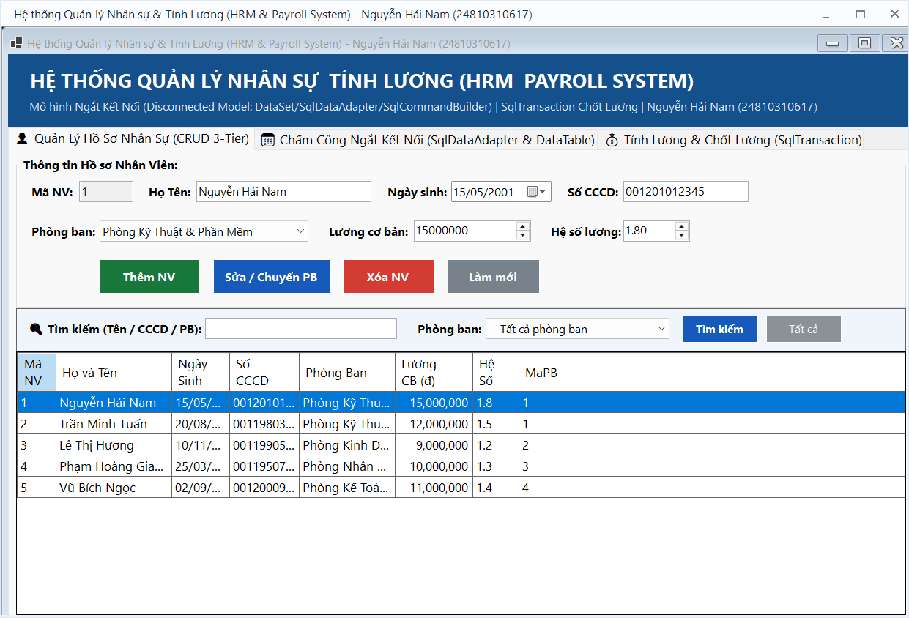
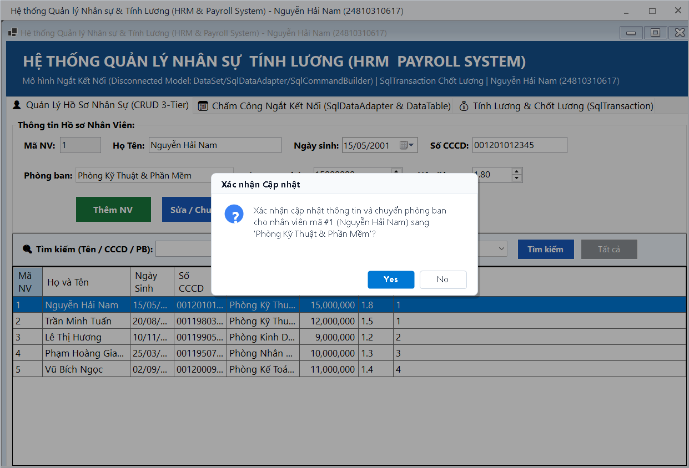
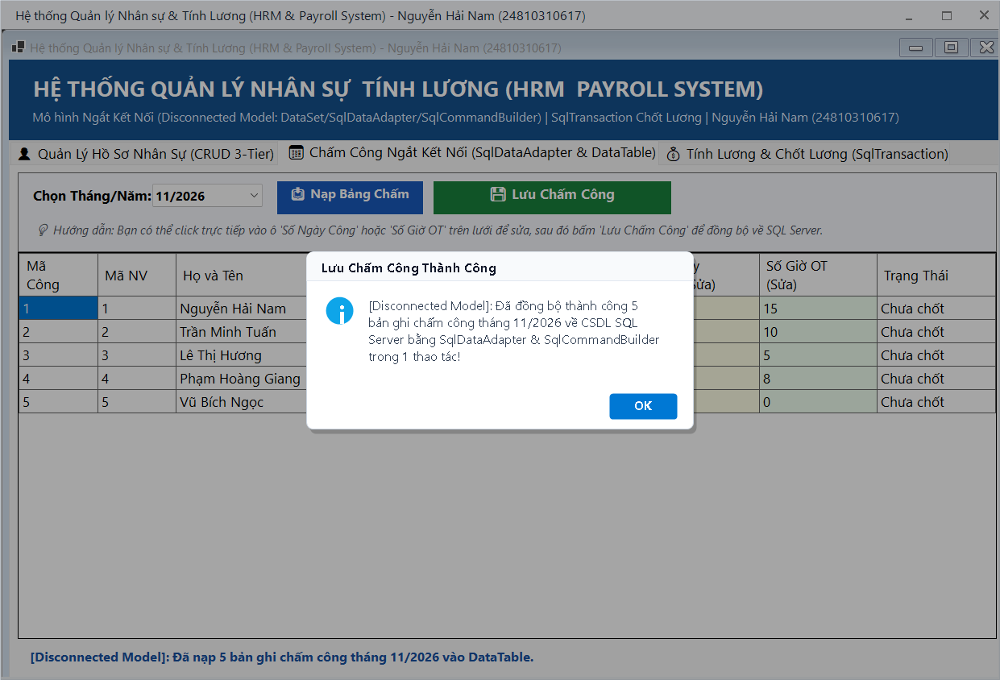
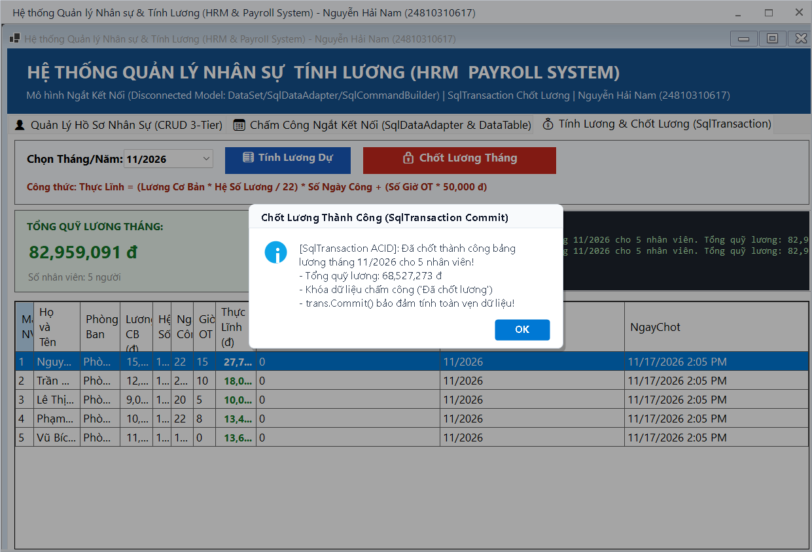
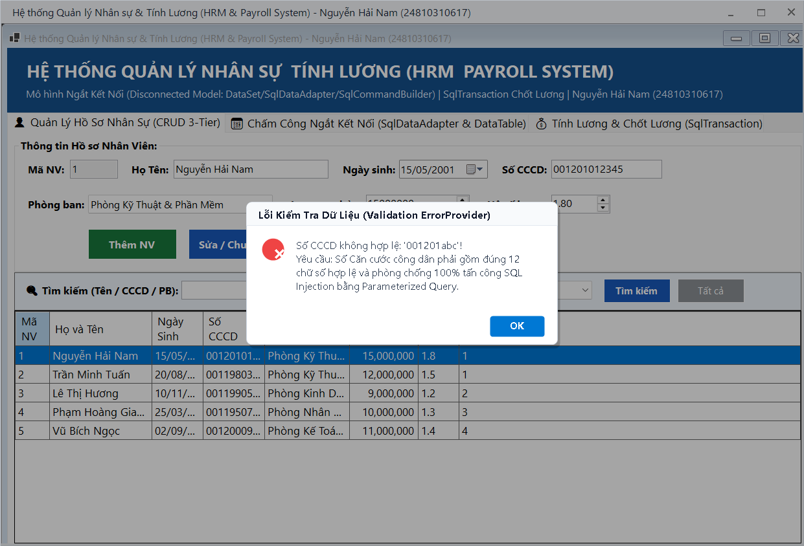

# BÁO CÁO ÔN TẬP THỰC HÀNH WINDOWS FORMS

## THÔNG TIN SINH VIÊN
- **Họ và tên:** Nguyễn Hải Nam
- **Mã số sinh viên:** 24810310617
- **Lớp:** D19CNPM3
- **Tên môn học:** Lập trình C# / Windows Forms (.NET 10)

---

## BÀI TẬP: BÀI 6.2 - HỆ THỐNG QUẢN LÝ NHÂN SỰ & TÍNH LƯƠNG (HRM & PAYROLL SYSTEM)

---

### MỤC 2: HÌNH ẢNH KẾT QUẢ CÁC MÀN HÌNH CHỨC NĂNG

#### 1. Màn hình Chính / Tổng quan hệ thống
Giao diện quản lý hồ sơ nhân sự với thông tin chi tiết, phân hệ phòng ban và bảng danh sách nhân viên:


#### 2. Màn hình Quản lý Danh mục (CRUD - Thêm/Sửa/Xóa Nhân viên, Chuyển phòng ban)
Chức năng thêm mới, sửa đổi thông tin, chuyển đổi phòng ban và xóa hồ sơ với hộp thoại xác nhận an toàn:


#### 3. Màn hình Thực thi Nghiệp vụ chính (Chấm công ngắt kết nối - Disconnected Model)
Sử dụng `SqlDataAdapter`, `DataTable` nạp dữ liệu chấm công; người dùng sửa ngày công và OT trực tiếp trên lưới rồi bấm "Lưu Chấm Công" để đồng bộ qua `SqlCommandBuilder` và `adapter.Update()`:


#### 4. Màn hình Báo cáo - Thống kê / Tính Lương & Chốt Lương
Tính lương tự động theo công thức và mở `SqlTransaction` để chốt lương cho toàn bộ nhân viên, khóa dữ liệu chấm công tháng:


#### 5. Minh họa An toàn Dữ liệu (Validation CCCD 12 số & Parameterized Query)
Kiểm tra tính hợp lệ của CCCD 12 số, xử lý lỗi bằng `ErrorProvider` và bảo vệ dữ liệu chống SQL Injection 100%:


---

### MỤC 3: CẤU TRÚC CƠ SỞ DỮ LIỆU (HRMDB)

```sql
-- 1. PhongBan (Phòng ban)
-- MaPB (INT IDENTITY PK), TenPB (NVARCHAR(100)), Mota (NVARCHAR(255))

-- 2. NhanVien (Hồ sơ nhân viên)
-- MaNV (INT IDENTITY PK), HoTen (NVARCHAR(100)), NgaySinh (DATETIME), CCCD (VARCHAR(20) UNIQUE), MaPB (FK PhongBan), LuongCoBan (DECIMAL(18,2) CHECK > 0), HeSoLuong (FLOAT DEFAULT 1.0)

-- 3. BangChamCong (Bảng chấm công tháng)
-- MaCong (INT IDENTITY PK), MaNV (FK NhanVien), ThangNam (VARCHAR(7)), SoNgayCong (FLOAT CHECK <= 31), SoGioOT (FLOAT DEFAULT 0), TrangThai (NVARCHAR(50))

-- 4. BangLuong (Bảng lương chi tiết)
-- MaLuong (INT IDENTITY PK), MaNV (FK NhanVien), ThangNam (VARCHAR(7)), ThucLinh (DECIMAL(18,2)), NgayChot (DATETIME), PK: (MaNV, ThangNam)
```

File script SQL khởi tạo CSDL nằm tại: [Database/ScriptDB.sql](Database/ScriptDB.sql).
